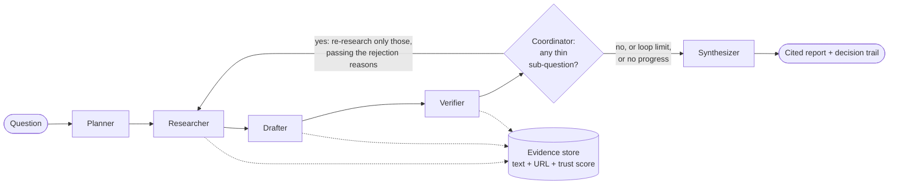

# DeepDive: a self-verifying research analyst

DeepDive answers a research question with a cited report in which **every claim has been checked against the source it points to**. Claims the source does not support are removed, thin areas trigger more research, and the whole run is logged so a person can see what was kept, what was rejected, and why.

Existing research tools cite sources, but the cited page often does not say what the sentence says. DeepDive is built around that one problem. Gathering information is the easy part. Making the final report true to its sources is the hard part.

- **Live demo:** `https://deepdive-8tgz.onrender.com/` (free tier: the first request after idle takes about a minute to wake. An example run is bundled, so there is something to look at straight away.)
- **Demo video:** `<your-video-url>`
- **All LLM calls go through [Mesh API](https://api.meshapi.ai/v1)**, from a single file (`llm.py`).

## A claim the model accepted and the code rejected

<!-- EXAMPLE:START -->
**Claim written by the drafter:**

> Solid-state batteries, which offer benefits like higher energy density and faster charging, face challenges such as high production costs and complex manufacturing.

**Cited source:**

- Latest EV Battery Technology in 2026: Solid-State, Sodium-Ion & Future EV Batteries (https://evsuper.in/latest-ev-battery-technology-2026)

**What the verifier model said:** *supported*, and it returned a quote.

**What the code found:**

```
quote not found in cited source (model said supported: The source explicitly states that solid-state batteries face high production costs and complex manufacturing challenges.)
```

The quote the model returned does not appear in the cited text, so the claim was marked unsupported and left out of the report. The trail records this as a `code_override`.

**The closest passages in the cited source:**

> Modern EV batteries are becoming safer, faster to charge, longer-lasting, and more affordable than ever before.
> In 2026, several breakthrough battery technologies are moving from research labs to commercial production, promising a new generation of electric vehicles with improved performance and lower ownership costs.
> Solid-state batteries are considered the biggest breakthrough in EV battery technology.

**For contrast, a claim that passed.** Its quote is copied word for word from the source:

> Solid-state batteries remain at the prototype and limited-production stage, with significant investments but no mass-market adoption as of mid-2026.

*Supporting quote:* "Solid-state batteries (SSBs) have attracted significant investment but remain at the prototype and limited-production stage."
<!-- EXAMPLE:END -->

## How it works



The pipeline is a [LangGraph](https://github.com/langchain-ai/langgraph) with explicit nodes and a real loop-back edge. All data lives in SQLite. The graph state only carries the run ID, the round number, and the loop targets.

### The agents

Each agent has its own prompt (all in `agents/prompts.py`), its own model setting, and its own tools.

| Agent | Job | Tools | What the code enforces on its output |
|---|---|---|---|
| **Planner** | Breaks the question into 4 to 6 sub-questions with 2 or 3 search queries each | none | JSON schema, duplicate removal, caps |
| **Researcher** | Searches, fetches pages, chunks them, scores source trust. On a loop-back it writes *new* queries from the rejection reasons | web search, `httpx` + `trafilatura` | URL and text de-duplication, relevance filter, chunks stored verbatim |
| **Drafter** | Writes atomic claims, each citing evidence IDs | read-only evidence store | may only cite chunk IDs it was shown; near-duplicate claims removed |
| **Verifier** | Judges one claim against only its cited chunks and returns a verbatim quote | none | quote check, number check, coverage check (below) |
| **Synthesizer** | Writes the report from verified claims only | none | citations by claim ID, number check, sentence grounding |
| **Coordinator** | Decides whether to loop back or write the report | none | thin-area rule, loop cap, no-progress stop |

### The verification layer

The language model gives an opinion. **Code has the final say.**

1. **Citation integrity.** The drafter only sees evidence labelled `[E12]` and can only cite those IDs. A claim citing an unknown ID is dropped. The model never writes a URL: URLs come from the evidence store when the report is rendered.
2. **Quote check.** For a claim to count as supported, the verifier must return a quote that appears in the cited chunk. Only whitespace, case, and typographic quotes are normalised. If the quote is not found, the claim becomes *unsupported*, even if the model said "supported". Invented and paraphrased quotes fail here.
3. **Number check.** Every number in the claim must appear in the quote, unless the number came from the user's own question (such as the year).
4. **Coverage check.** At least 70% of the claim's meaningful words must appear in the quote. This catches claims that add a cause, a comparison, or a consequence the quote never states.
5. **Grounded writing.** The synthesizer sees only verified claims. Any paragraph with no citation, an unknown citation, or a number not found in the cited claims is dropped. Each remaining sentence is compared with the claims it cites. A sentence that drifts from them is replaced by the verified claim text itself, so no verified fact is lost and no commentary is added.
6. **Thin-area rule.** After verification, a sub-question with fewer than 2 verified claims, or verified claims from fewer than 2 distinct domains, is *thin*. Thin sub-questions go back to the researcher. When the limit is reached or a round adds nothing, the report lists the area under **insufficient evidence** instead of padding.

Source trust is a visible table in `tools/source_tiers.py` (primary sources and `.gov`/`.edu` = 1.0, major news = 0.8, analyst research = 0.7, reference = 0.6, user-generated = 0.3, unknown = 0.5). It ranks which pages get fetched, and which chunks the drafter sees first.

### The decision trail

Every step is written to a `trail_events` table: the sub-questions, each search, each source stored or skipped, every claim drafted, every claim verified or rejected with the reason, every loop-back with its feedback, and every paragraph the synthesizer dropped. The web UI shows it live while a run is going, with kept claims and rejected claims side by side. Rejections that the code made against the model's verdict are marked `code_override`.

## Evaluation

All numbers are measured by scripts in `eval/`. Nothing here is typed in by hand: `eval/results.md` is generated and this section is copied from it by `scripts/update_readme.py`.

<!-- RESULTS:START -->
Run on 2026-10-16. Models: planner `openai/gpt-4o-mini`, drafter `openai/gpt-4o-mini`, verifier `openai/gpt-4.1-mini`, synthesizer `openai/gpt-4.1-mini`. Quote coverage threshold 0.7, sentence coverage 0.85, max 2 research loops.

### 1. End-to-end benchmark

| Question | Domain | Drafted | Verified | Pass rate | Loops | Thin sub-questions (start to end) | Sources cited | Avg trust | Tokens |
|---|---|---|---|---|---|---|---|---|---|
| q01 | finance | 35 | 24 | 69% | 1 | 1 to 0 of 5 | 11 | 0.58 | 75k |
| q02 | health | 44 | 37 | 84% | 2 | 2 to 1 of 6 | 14 | 0.79 | 109k |
| q03 | policy | 34 | 31 | 91% | 1 | 1 to 0 of 5 | 12 | 0.75 | 68k |
| q04 | climate | 33 | 30 | 91% | 1 | 1 to 0 of 5 | 12 | 0.58 | 67k |
| q05 | energy | 40 | 33 | 82% | 1 | 1 to 0 of 6 | 16 | 0.80 | 78k |
| q06 | economics | 47 | 34 | 72% | 1 | 2 to 0 of 6 | 14 | 0.57 | 95k |
| q07 | technology | 35 | 31 | 89% | 1 | 1 to 0 of 5 | 14 | 0.71 | 73k |
| q08 | work | 29 | 28 | 97% | 0 | 0 to 0 of 5 | 12 | 0.62 | 58k |
| q09 | space | 38 | 29 | 76% | 1 | 4 to 2 of 6 | 13 | 0.62 | 89k |
| q10 | health | 28 | 23 | 82% | 0 | 0 to 0 of 5 | 13 | 0.75 | 61k |
| q11 | economics | 40 | 35 | 88% | 1 | 2 to 1 of 6 | 13 | 0.73 | 94k |
| q12 | agriculture | 42 | 26 | 62% | 2 | 2 to 0 of 5 | 11 | 0.55 | 86k |

**12 questions. 361 of 445 drafted claims verified (81% overall, 82% averaged per question).**

- Coverage: the share of sub-questions with enough verified evidence (at least 2 claims from 2+ domains) went from **74% after the first pass to 94% after the research loop** (mean 1.0 loops per question).
- The loop contributed 61 of the 361 verified claims.
- Sources behind verified claims: 12.9 per question on average, average trust score 0.67, 35% from high-trust domains (score 0.8 or more).
- Source disagreements flagged in reports: 0.
- Cost per question: about 55 LLM calls, 80k tokens, 4.9 minutes.

### 2. Against an unverified baseline

A tool that publishes every drafted claim would have published 445 claims, and only **81%** of them are supported by the source they cite. DeepDive kept 361 and removed or downgraded 84. In 62 of those cases the model had said "supported" and the code checks overruled it.

### 3. Adversarial test of the verifier

Verifier model: `openai/gpt-4.1-mini`. Test claims were built from verified claims in 12 runs.

| Planted fault | n | Caught by LLM alone | Caught by LLM + code checks |
|---|---|---|---|
| A figure changed | 20 | 85% | 100% |
| Meaning reversed | 20 | 95% | 95% |
| Unsupported cause or forecast added | 20 | 100% | 100% |
| True claim, wrong source | 20 | 100% | 100% |
| **All planted faults** | 80 | **95%** | **99%** |

Control (correct claims left untouched): 100% still accepted after all checks (20 of 20). Every extra check can cost some true claims, and this is that cost.

Faults that got through (see `adversarial.json`):
- *reversal*: "Reliance on DAC could increase the urgency of reducing emissions at the source."


### How the evaluation works

| Measurement | What it answers | Script |
|---|---|---|
| End-to-end benchmark (12 questions across 12 domains, including contested and niche topics) | How many drafted claims survive verification? How much did the research loop improve coverage? | `eval/run_eval.py` |
| Unverified baseline | What a tool that publishes every drafted claim would have published | derived from the benchmark |
| Adversarial test | Of known-false claims planted next to real evidence (changed figure, reversed meaning, added cause, wrong source), how many does the verifier catch, with and without the code checks? Correct claims are included as a control. | `eval/adversarial.py` |
| Blind human spot check | When a person reads the source text without seeing the system's verdict, how often do they agree with it? Sampled from both kept and rejected claims. | `eval/spot_check.py` |

The share of verified claims in the final report is 100% by construction, because the report only contains verified claims. That is why the evaluation measures the verifier itself, with planted faults and a human check, rather than reporting that number.

### Limitations

- The verifier is an LLM plus heuristic code checks. It is not a proof. The checks catch fabricated quotes, wrong numbers, and claims wider than their quote, but a supported claim can still go slightly beyond its quote.
- The planted faults are synthetic and fairly blunt. Subtle real-world errors are harder.
- Report prose is checked sentence by sentence with a word-overlap heuristic, not a full entailment check.
- Web search results change from day to day, so a re-run gives different numbers.
- Page text extraction occasionally glues words together (for example "nickel-containingchemistries"). The quote check still works, because the chunk has the same text, but it can show up in the report.
- DuckDuckGo search may throttle cloud servers. The search provider lives in one file (`tools/search.py`) and can be swapped.

## Design decisions

1. **The model never writes a citation.** Claims point at evidence IDs, and code turns IDs into links. A model cannot invent a source it was never shown.
2. **Code outranks the model.** An LLM judge is lenient in a predictable way, so the checks that matter (quote present, numbers present, wording covered) are plain functions with unit tests. The trail records every case where code overrode the model.
3. **The report contains verified claims only.** Partial and unsupported claims stay visible in the appendix with their reasons, but never in the body. This gives up some coverage in exchange for claims a reader can click and confirm.
4. **A strict check beat a high pass rate.** A looser number check raised the pass rate but let claims through whose quotes did not contain their key details. We tightened it and accepted the lower number. The only exemption is numbers that appear in the user's question.
5. **The loop is targeted and bounded.** Only thin sub-questions are re-researched. The researcher is told why earlier claims failed, so it searches a different angle instead of repeating itself. A loop stops at the cap, when a round adds nothing, or when the account runs out of credit.
6. **Say "insufficient evidence" instead of padding.** Thin areas are listed in the report as thin.
7. **Plain SQLite and threads, one process.** Runs are background threads, and limits are counted from the database. This is simple to deploy and easy to inspect. It scales to a demo, not to a service.
8. **One place for model calls.** `llm.py` is the only file that talks to a model, so Mesh routing, retries, and usage counting live in one spot. Retries apply to temporary errors only, never to a billing error.
9. **Cheap models where mistakes are caught anyway.** The drafter and planner can run on a small model because the verifier checks the drafter. The verifier gets the strongest model you can afford.

## Run it locally

Requires [uv](https://docs.astral.sh/uv/) and a Mesh API key (it starts with `rsk_`).

```bash
git clone https://github.com/Sharathpd14/Deep-Dive.git
cd Deep-Dive
uv sync
cp .env.example .env          # then put your key in MESH_API_KEY
uv run uvicorn app:app
```

Open http://localhost:8000. Interactive API docs are at http://localhost:8000/docs.

From the command line:

```bash
uv run python -m graph "What are the main risks of investing in the EV battery market in 2026?"
uv run python -m graph --resume            # continue the latest run
```

With Docker:

```bash
docker compose up --build
```

## Deploy

`render.yaml` is a Render Blueprint. Create a Blueprint from the repo, then enter `MESH_API_KEY` and `ACCESS_CODE` in the dashboard. The free tier has no persistent disk, so runs reset after idle. A finished example run is bundled in `demo_data/` and loaded at every startup. To keep data, use a paid instance and uncomment the disk block.

## Configuration

Everything is an environment variable (see `.env.example`). Key ones:

| Variable | Default | Meaning |
|---|---|---|
| `MESH_API_KEY` | required | Mesh API key. The app refuses to start without it. |
| `MESH_BASE_URL` | `https://api.meshapi.ai/v1` | Mesh gateway |
| `PLANNER_MODEL`, `DRAFTER_MODEL`, `VERIFIER_MODEL`, `SYNTHESIZER_MODEL`, `CHEAP_MODEL` | see `config.py` | Model per agent |
| `MAX_LOOPS` | 2 | Maximum research loop-backs |
| `MIN_VERIFIED_CLAIMS`, `MIN_DISTINCT_DOMAINS` | 2, 2 | What counts as enough evidence for a sub-question |
| `MIN_QUOTE_COVERAGE`, `MIN_SENTENCE_COVERAGE` | see `config.py` | Strictness of the wording checks |
| `MAX_CONCURRENT_RUNS`, `MAX_RUNS_PER_HOUR` | 2, 10 | Spending guard for public demos |
| `ACCESS_CODE` | empty | If set, starting a run requires this code |
| `SHOW_RECENT_RUNS` | true | Set false on a public deployment |
| `DB_PATH` | `data/deepdive.db` | SQLite file |

## API

| Endpoint | What it does |
|---|---|
| `POST /runs` | Start a run. Returns the run ID immediately (HTTP 202). |
| `GET /runs/{id}?after=N` | Status, sub-questions, claim counts, and new trail events since event N |
| `GET /runs/{id}/claims` | Every claim with verdict, quote, reason, and sources |
| `GET /runs/{id}/report` | The report as Markdown |
| `GET /runs/{id}/view`, `GET /runs/{id}/report/view` | The live trail page and the printable report page (use the browser's "Save as PDF") |
| `GET /health` | Health check |

## Project structure

```
agents/      planner, researcher, drafter, verifier, synthesizer, prompts
tools/       search, fetch, chunker, retrieve (gathering), source_tiers
db/          schema, connection, store (the only file with SQL)
graph.py     LangGraph wiring and the loop-back decision
runner.py    background runs and spending limits
app.py       FastAPI routes and pages (templates/, static/)
coverage.py  "is this sub-question thin?" rule
textcheck.py word-overlap helper used by the verifier and synthesizer
eval/        benchmark, adversarial test, human spot check, results
seed.py      bundled example run (demo_data/)
tests/       offline unit tests (no network, no credits)
```

## Tests

```bash
uv run pytest
```

Every test uses fake model and search responses, so tests are free and need no network.